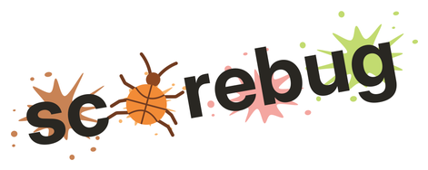

# Scorebugs

TV-style scorebugs for Home Assistant: your teams' games drawn the way they look on a broadcast, from the first always-on score boxes
of the 1990s to this season's, on any dashboard.

- **289 looks** across 12 sports, with scorebugs starting from the early 1990s. Supported sports include American football, baseball,
  hockey, basketball, soccer, golf, motor racing, tennis, MMA, Australian football, cricket and volleyball. Any college sport falling
  under these categories is also supported. Retro scorebugs can come out a little soft to evoke that childhood nostalgia.
- **Follow your teams**: 198 leagues in 17 sports. Each team gets a sensor with its current or next game: score, clock, period, down
  and distance, count and bases, power play, bonus, records, the network and more.
- **A Scorebug card** that adds itself to your dashboards. Pick your team, then click the look you want from live previews.
- **One look everywhere, or one per team**, or let each game match **the network showing it**. Every team also gets a Look entity
  for automations.
- **Looks that fit more than one sport**: football, basketball and hockey looks draw each other's games, and baseball looks draw them
  too, with the period, the clock and one detail (down and distance, the bonus, a power play) in place of the count, outs and bases.
- **Upload your own touches**: logo versions, your own team logos from years past, your own picture in the network's spot, playoff
  looks, panel textures, and much more.
- Reads [Team Tracker](https://github.com/vasqued2/ha-teamtracker) sensors too, but doesn't need it: Scorebugs fetches its own scores.

## Install

Needs Home Assistant 2026.10 or newer and HACS.

1. **HACS** > three-dot menu > **Custom repositories**: add `https://github.com/git-nimrod/ha-scorebugs`, type **Integration**.
2. Search **Scorebugs** in HACS, **Download**, then restart Home Assistant.
3. **Settings > Devices & services > Add integration > Scorebugs**.
4. **Scorebugs > Configure > Add a team**: pick the sport, the league and your team. Repeat for each team.
5. On a dashboard: **Edit > Add card > Scorebug**, pick your team and a look.

The full walk-through, with pictures, is in [Getting started](docs/getting-started.md).

## Docs

- [Getting started](docs/getting-started.md): install, follow your teams, add the card
- [Settings](docs/settings.md): everything under Configure, and the Look entities
- [Card options](docs/card-options.md): every card option, including the ones only YAML offers
- [Every look](docs/bugs.md): all 289, with the id to use in YAML
- [Leagues you can follow](docs/leagues.md): all 198
- [Troubleshooting](docs/troubleshooting.md)
- [Release notes](docs/release-notes/v1.0.0.md)

## Only fetches what you follow

You have the ability to have one scoreboard request per league you have a team in. It asks every 20 seconds while one of your games is live, every
30 seconds just before it starts, every 5 minutes on game day and hourly otherwise. Extra logo versions are looked up once per team and
kept for 30 days.

Logos are served by your own Home Assistant (`/scorebugs/logo`). The first time a logo is drawn, Home Assistant fetches it once from
ESPN's or Wikimedia's image servers and keeps a copy in `/config/.cache/scorebugs/logos` (refreshed monthly, at most 100 MB, not in
backups). Your screens only talk to Home Assistant, and logos they have shown keep working when ESPN is down. If Home Assistant can't
serve a logo, the screen loads it straight from ESPN or Wikimedia instead.

## Not affiliated

Not affiliated with any network or league. This is a project run by a sports enthusiast who just wants everyone to be able to get their
favorite looks of their games on any device they choose. See [NOTICE.md](NOTICE.md).

## License

MIT. The bundled fonts are under the SIL Open Font License 1.1 (see `custom_components/scorebugs/frontend/fonts/README.md`).
